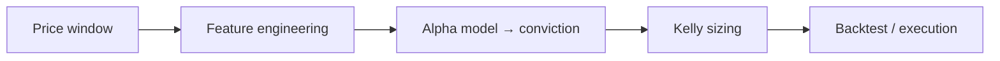

<p align="center">
  
</p>

<h1 align="center">AI Crypto Trading Bot</h1>

<p align="center">
  <strong>AI-driven cryptocurrency trading bot — feature engineering, alpha scoring, and Kelly sizing in Python.</strong><br>
  Turn raw price data into a conviction score, size with fractional Kelly, and backtest the whole pipeline.
</p>

<p align="center">
  <em>Built and maintained by <a href="https://viprasol.com">Viprasol Tech</a> — Fintech Experts. Full-Stack Builders.</em>
</p>

<p align="center">
  <a href="https://github.com/Viprasol-Tech/ai-crypto-trading-bot/actions/workflows/ci.yml"></a>
  <a href="LICENSE"></a>
  
  <a href="https://t.me/viprasol_help"></a>
  <a href="https://github.com/Viprasol-Tech/ai-crypto-trading-bot/stargazers"></a>
</p>

---

> ## ⚠️ Disclaimer
> This software is for **educational purposes only** and is **not financial advice**. Cryptocurrency trading is highly volatile and involves substantial risk, including the **total loss of capital**. Backtest results are **not** indicative of future performance. The bundled alpha model is a transparent baseline, **not** a profitable strategy. Always paper-trade first. **Use at your own risk** — Viprasol Tech assumes no responsibility for your trading results.

---

## ✨ Features

- 🧠 **AI alpha pipeline** — features → conviction score → position size, cleanly separated.
- 🔬 **Feature engineering** — momentum, mean-reversion, volatility, and trend-strength from OHLCV.
- 🔌 **Pluggable model** — ship `LinearAlpha`, or drop in sklearn / XGBoost / an LLM sentiment score via one `score()` method.
- 🎯 **Fractional-Kelly sizing** — scale in with conviction, capped so no trade bets the bankroll.
- 🧪 **Backtester** — run the whole pipeline over a price series and get the equity curve.
- 🖥️ **CLI** — `ai-crypto-trading-bot demo` runs it end to end.
- ⚙️ **Modern tooling** — numpy, ruff, mypy (strict), pytest, GitHub Actions CI.

## 🚀 Quickstart

```bash
git clone https://github.com/Viprasol-Tech/ai-crypto-trading-bot.git
cd ai-crypto-trading-bot
python -m pip install -e ".[dev]"

ai-crypto-trading-bot demo
```

## 🧩 Plug in your own model

```python
from ai_crypto_trading_bot.alpha.model import AlphaModel
from ai_crypto_trading_bot.features.engineering import Features

class MyModel(AlphaModel):
    def score(self, features: Features) -> float:
        # return your model's conviction in [-1, 1]
        return 0.4
```

## 🏗️ Architecture



## 🗺️ Roadmap

- [x] Feature engineering + linear alpha + Kelly sizing + backtest
- [ ] sklearn / gradient-boosting alpha examples
- [ ] LLM sentiment feature
- [ ] Live exchange execution (ccxt)

## 🤝 Contributing

PRs welcome — see [CONTRIBUTING.md](CONTRIBUTING.md) and our [Code of Conduct](CODE_OF_CONDUCT.md).

## 📬 Contact — Viprasol Tech Private Limited

- 🌐 Website: [viprasol.com](https://viprasol.com)
- ✉️ Email: [support@viprasol.com](mailto:support@viprasol.com)
- 💬 Telegram: [t.me/viprasol_help](https://t.me/viprasol_help) · 📱 WhatsApp: +91 96336 52112
- 🐙 GitHub: [@Viprasol-Tech](https://github.com/Viprasol-Tech) · 💼 [LinkedIn](https://www.linkedin.com/in/viprasol/) · 𝕏 [@viprasol](https://twitter.com/viprasol)

> *Viprasol Tech — fintech software, algorithmic trading systems, MT4/MT5 bots, AI voice agents, and B2B SaaS. Need a custom build? [Get in touch](mailto:support@viprasol.com).*

## 📄 License

[MIT](LICENSE) © 2025 Viprasol Tech Private Limited
