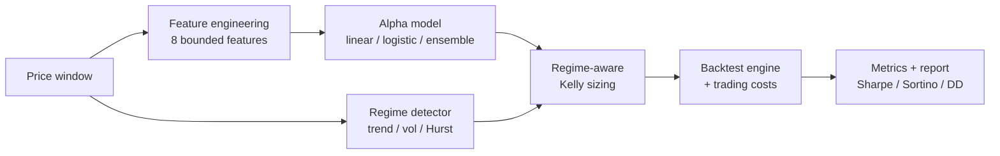

<p align="center">
  
</p>

<h1 align="center">AI Crypto Trading Bot</h1>

<p align="center">
  <strong>An AI alpha engine for crypto — feature engineering → model conviction → regime-aware Kelly sizing → backtest, in pure Python.</strong><br>
  Turn raw price data into a calibrated conviction score, adapt sizing to the market regime, and measure it with quant-grade metrics.
</p>

<p align="center">
  <em>Built and maintained by <a href="https://viprasol.com">Viprasol Tech</a> — Fintech Experts. Full-Stack Builders.</em>
</p>

<p align="center">
  <a href="https://github.com/Viprasol-Tech/ai-crypto-trading-bot/actions/workflows/ci.yml"></a>
  <a href="LICENSE"></a>
  
  
  
  
  <a href="https://t.me/viprasol_help"></a>
  <a href="https://github.com/Viprasol-Tech/ai-crypto-trading-bot/stargazers"></a>
</p>

---

> ## ⚠️ Disclaimer
> This software is for **educational and research purposes only** and is **not financial advice**. Cryptocurrency trading is highly volatile and involves substantial risk, including the **total loss of capital**. Backtest results are **simulated, ignore real-world frictions beyond modelled fees/slippage, and are not indicative of future performance**. The bundled alpha models are transparent baselines, **not** profitable strategies. Always paper-trade first and never risk money you cannot afford to lose. **Use at your own risk** — Viprasol Tech assumes no responsibility for your trading results.

---

## ✨ Features

- 🧠 **Clean AI pipeline** — features → alpha conviction → regime → Kelly sizing → backtest, each stage decoupled and independently testable.
- 🔬 **Eight engineered features** — momentum, mean-reversion, volatility, trend strength, **RSI**, **MACD**, **Bollinger position**, and **acceleration**, all bounded for direct model use.
- 🤖 **Three alpha models** — `LinearAlpha` (transparent weighted sum), `LogisticAlpha` (calibrated sigmoid, drop-in for a fitted classifier), and `EnsembleAlpha` (weighted blend of any models).
- 🌦️ **Regime detection** — classifies the tape into *trending-up / trending-down / ranging / volatile* via drift, realised vol, and a Hurst estimate, then scales risk accordingly.
- 🎯 **Regime-aware fractional-Kelly sizing** — scale in with conviction, dial risk down in turbulent markets, optional short side, hard bankroll cap.
- 📊 **Quant-grade metrics** — Sharpe, Sortino, Calmar, max drawdown, annualised return/vol, and hit rate from any equity curve.
- 💸 **Realistic costs** — configurable fee + slippage (bps) charged on every rebalance.
- 🧾 **Reports** — ASCII report (CI-safe) and a Rich table out of the box.
- 🖥️ **CLI** — `demo`, `backtest`, `regime`, `models`, `version` subcommands.
- ⚙️ **Modern tooling** — pydantic v2, numpy, ruff, mypy (strict), pytest, GitHub Actions CI.

## 🚀 Quickstart

```bash
git clone https://github.com/Viprasol-Tech/ai-crypto-trading-bot.git
cd ai-crypto-trading-bot
python -m pip install -e ".[dev]"

ai-crypto-trading-bot demo                              # full pipeline + report
ai-crypto-trading-bot backtest --model ensemble --plain # ensemble, ASCII report
ai-crypto-trading-bot regime                            # classify current regime
ai-crypto-trading-bot models                            # list bundled models
```

Sample report:

```text
====================================================
 AI Crypto Trading Bot - Backtest Report
====================================================
 Model              : Ensemble[LinearAlpha, LogisticAlpha]
 Bars               : 400
 Trades             : 197
 Start equity       : $10,000.00
 Final equity       : $11,563.60
----------------------------------------------------
 Sharpe ratio       : 6.70
 Sortino ratio      : 10.04
 Max drawdown       : 0.98%
 Hit rate           : 65.5%
====================================================
```

## 🧩 Usage

```python
from ai_crypto_trading_bot import (
    CostModel, EngineConfig, EnsembleAlpha, LinearAlpha, LogisticAlpha, run_backtest,
)

prices = [...]  # your OHLC close series

# Blend a transparent linear model with a logistic classifier.
model = EnsembleAlpha(models=[LinearAlpha(), LogisticAlpha()], weights=[0.6, 0.4])

config = EngineConfig(
    window=24,
    starting_equity=10_000.0,
    costs=CostModel(fee_bps=10.0, slippage_bps=5.0),
    use_regime=True,
)

result = run_backtest(prices, model=model, config=config)
m = result.metrics()
print(f"Return {m.total_return_pct:+.2f}%  Sharpe {m.sharpe:.2f}  MaxDD {m.max_drawdown_pct:.2f}%")
```

Plug in your own model by implementing one method:

```python
from ai_crypto_trading_bot.alpha.model import AlphaModel
from ai_crypto_trading_bot.features.engineering import Features

class MyModel(AlphaModel):
    def score(self, features: Features) -> float:
        # return your conviction in [-1, 1] (e.g. an sklearn / XGBoost / LLM score)
        return 0.4
```

A runnable end-to-end script lives in [`examples/run_pipeline.py`](examples/run_pipeline.py).

## 🏗️ Architecture



## 📚 API & module map

| Module | Key API | What it does |
| --- | --- | --- |
| `features.engineering` | `compute_features`, `Features` | 8 bounded features from a price window |
| `alpha.model` | `LinearAlpha`, `LogisticAlpha`, `EnsembleAlpha` | map features → conviction in [-1, 1] |
| `regime` | `RegimeDetector`, `Regime`, `RegimeSignal` | classify market regime + risk multiplier |
| `sizing` | `target_fraction`, `SizingConfig` | fractional-Kelly, regime-aware, optional short |
| `metrics` | `compute_metrics`, `max_drawdown` | Sharpe, Sortino, Calmar, drawdown, hit rate |
| `config` | `EngineConfig`, `CostModel` | validated pydantic configuration |
| `backtest` | `run_backtest`, `BacktestResult` | run the full pipeline → equity curve |
| `report` | `render_text`, `print_report` | ASCII / Rich performance report |

## 🗺️ Roadmap

- [x] Feature engineering (8 features) + linear / logistic / ensemble alphas
- [x] Regime detection + regime-aware Kelly sizing
- [x] Trading costs, quant metrics, and reports
- [ ] sklearn / gradient-boosting alpha example with a fit step
- [ ] LLM sentiment feature
- [ ] Walk-forward / parameter-sweep harness
- [ ] Live exchange execution (ccxt)

## ❓ FAQ

**Is this profitable?** No. The bundled models are transparent baselines for learning the architecture. Treat any backtest as a sandbox, not a strategy.

**Can I trade live?** Not yet — there is no exchange adapter (it is on the roadmap). The engine is designed so an execution layer slots in after sizing.

**Do I need a GPU or heavy ML deps?** No. Everything runs on numpy + pydantic. `LogisticAlpha` is the natural drop-in if you later fit a scikit-learn classifier.

**How do I use my own data?** Pass any list of close prices to `run_backtest`. Features are computed from a trailing window each bar.

## 🤝 Contributing

PRs welcome — see [CONTRIBUTING.md](CONTRIBUTING.md) and our [Code of Conduct](CODE_OF_CONDUCT.md). Please run `ruff check .`, `mypy src`, and `pytest` before opening a PR.

## Contact — Viprasol Tech Private Limited

- Website: [viprasol.com](https://viprasol.com)
- Email: [support@viprasol.com](mailto:support@viprasol.com)
- Telegram: [t.me/viprasol_help](https://t.me/viprasol_help) | WhatsApp: +91 96336 52112
- GitHub: [@Viprasol-Tech](https://github.com/Viprasol-Tech) | [LinkedIn](https://www.linkedin.com/in/viprasol/) | X [@viprasol](https://twitter.com/viprasol)

> *Viprasol Tech — fintech software, algorithmic trading systems, MT4/MT5 bots, AI voice agents, and B2B SaaS. Need a custom build? [Get in touch](mailto:support@viprasol.com).*

## License

[MIT](LICENSE) (c) 2025 Viprasol Tech Private Limited
